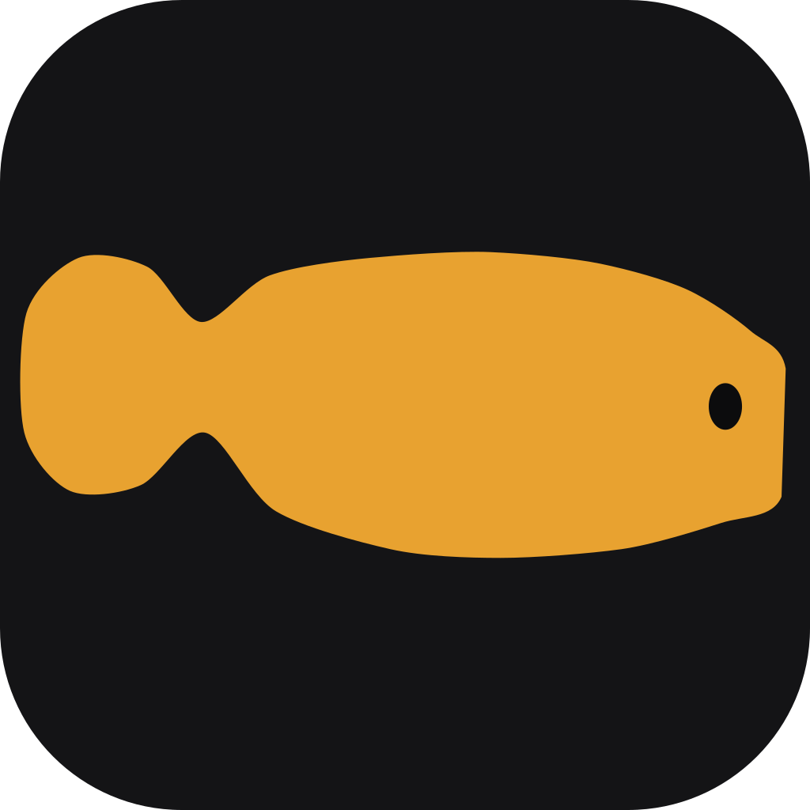
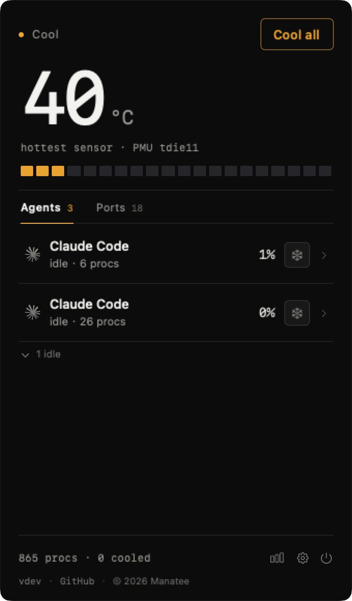
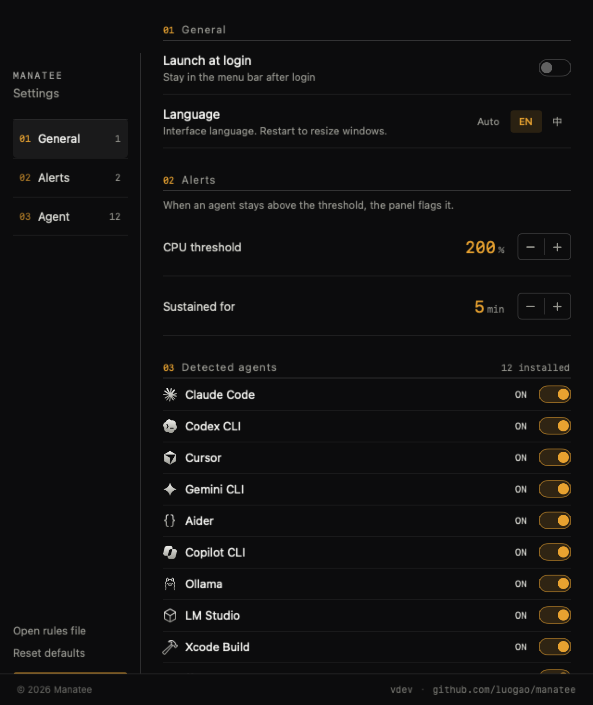
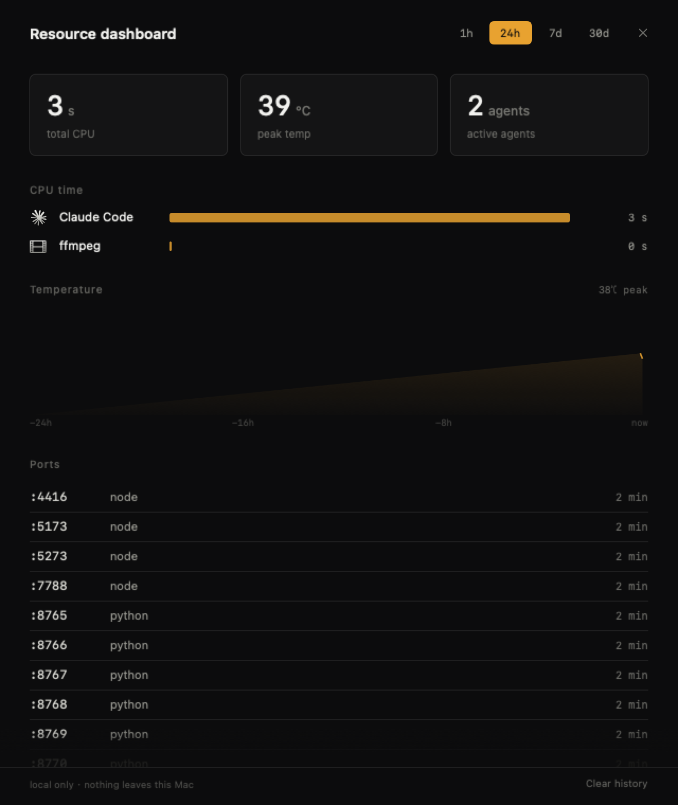
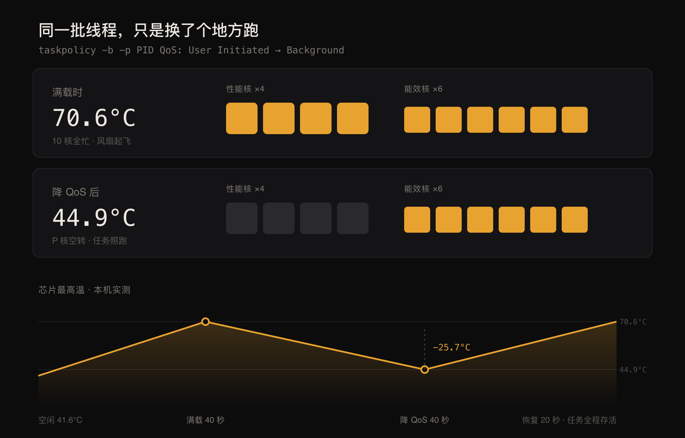

# Manatee

[English](README.md) · [简体中文](README.zh-CN.md)



[](https://github.com/luogao/manatee/releases)
[](LICENSE)
[](#install)

**Turn the heat down, don't put out the fire.**

Run a few AI agents at once and the fans take off. You don't need the vague answer "something is using CPU" — you need to know *which* agent, *for how long*, and whether it can be saved.

Manatee lives in your menu bar. It folds each agent's entire process tree into one row, flags how long it has been running hot, and moves it to the efficiency cores: **the task keeps running, it just stops hogging every core.**

> The name comes from the manatee — it eats a tenth of its body weight in seagrass every day, digests extremely slowly, and never sprints.

<p align="center">
  &nbsp;&nbsp;
  &nbsp;&nbsp;
  
</p>

<p align="center"><sub>Menu bar panel · Settings · Resource dashboard</sub></p>

## Features

- **Live chip temperature** — the menu bar shows `52°` and changes color with the heat
- **Sessions, not processes** — an agent's node/npm/child processes collapse into one row
- **One-click cooling** — move a session to efficiency cores; it keeps running, just slower. Restore anytime
- **Sustained-load alerts** — a session above 200% CPU for 5 minutes gets flagged inline with how long it has been hot
- **Port monitor** — who is holding `:5173`; servers whose terminal is gone get marked "stray" and can be killed in one click
- **Resource dashboard** — 1h / 24h / 7d / 30d windows: who burned the most CPU, when the temperature spiked
- **Broad agent support** — Claude Code / Codex / Cursor / Gemini CLI / Aider / Copilot CLI / Pi / Ollama / LM Studio / Xcode Build / ffmpeg / Docker

## Install

**Homebrew (recommended)**

```bash
brew install --cask luogao/tap/manatee
```

One command — the cask strips the quarantine flag, so it works right after install.

**Download**

Grab `Manatee-<version>.zip` from [Releases](https://github.com/luogao/manatee/releases) and drag it into `/Applications`.

> The build is ad-hoc signed, so Gatekeeper may block the first launch. Right-click → Open, or:
> ```bash
> xattr -d com.apple.quarantine /Applications/Manatee.app
> ```

**From source**

```bash
git clone https://github.com/luogao/manatee.git
cd manatee
./scripts/bundle.sh          # build + bundle + ad-hoc sign
cp -R build/Manatee.app /Applications/
open /Applications/Manatee.app
```

> Don't use `brew install --cask <raw URL>` — recent Homebrew treats the URL as a cask name and fails with `No Cask with this name exists`.

## Usage

1. After launch, `52°` appears in the menu bar. No Dock icon.
2. Click it to expand the panel: every agent session, its CPU, and its child processes.
3. If a number looks alarming, click the cool button on that row. Or hit "Cool all" at the bottom.
4. When you're done, click "Restore" and the processes go back to normal scheduling.

Right-click the menu bar icon for the dashboard, preferences, launch-at-login (off by default), and quit.

## Configuration

Settings live in `~/Library/Application Support/Manatee/rules.json`, generated on first launch.

Add your own agents, whitelist ports, change alert thresholds. **Breaking it doesn't crash the app** — the bad file is backed up and the defaults are restored.

## How it works

| Part | Approach |
|------|----------|
| Temperature | `IOHIDEventSystemClient` (private API, no sudo) |
| Processes | Full-table `libproc` scan + `proc_pid_rusage` deltas for CPU% |
| Attribution | argv fingerprints + ppid chain + pgid fallback |
| Cooling | `taskpolicy -b -p PID` → Background QoS (efficiency cores only) |
| Restore | `taskpolicy -B -p PID` |
| Storage | Local SQLite sampling: 48h raw, 90d hourly aggregates |

### What cooling actually changes

It is not `SIGSTOP`, it is not `nice` — the process keeps running. What changes is the **scheduling class**: the thread's QoS drops from User Initiated to Background. The system reacts in three ways: prefer efficiency cores, hand out smaller time slices, and coalesce timer wakeups.

The first one matters most. An Apple Silicon P-core burns several times the power of an E-core without being several times faster. Move the same threads to E-cores and heat output drops by more than half; the cost is a longer wall-clock time — which for "I just need the result" agent work is barely noticeable.

<p align="center"></p>

<p align="center"><sub>8 CPU-bound threads oversubscribing 6 efficiency cores, measured locally. Full method and data in <a href="docs/POC-REPORT.md">POC-REPORT</a></sub></p>

Note this is advisory scheduling, not hard affinity: when the E-cores fill up, threads still spill over to P-cores. So the effect depends on the system being willing to keep E-cores for you — under normal load, it is.

The dashboard's sampling strategy and the trade-offs behind it are documented in [docs/DASHBOARD.md](docs/DASHBOARD.md).

## Requirements & limitations

- Apple Silicon, macOS 13+
- Uses a private API, so it can't ship on the Mac App Store
- Can only cool processes owned by the same user (no sudo-owned docker/root processes)
- The notch layout needs a notched Mac to verify; without a notch it falls back to the menu bar

## Development

```bash
./scripts/check.sh      # build + unit tests + e2e — run before committing
swift build -c release  # produce the binary
```

Tests: `Tests/ManateeTests/` covers agent matching rules, session aggregation, and dashboard storage. `Manatee --e2e` is a windowless, permission-free startup smoke test. CI runs the same three steps.

Handy CLI flags:

```bash
.build/debug/Manatee --dump        # temperature + agent sessions + top CPU
.build/debug/Manatee --cool-test   # cool the hottest agent for 25s, print the delta
.build/debug/Manatee --render      # offscreen render of the panel (--alert / --dev inject state)
.build/release/Manatee --ports     # list stray dev servers only
.build/release/Manatee --bench     # scan/temperature baseline timings
.build/debug/Manatee --demo        # open the panel on launch
```

More docs:

- Product requirements and design: [PRD.md](PRD.md)
- Measurements and method: [docs/POC-REPORT.md](docs/POC-REPORT.md)
- Notes for contributors / AI agents: [AGENTS.md](AGENTS.md)

## Privacy

Fully local. No network calls, no telemetry, no account. Dashboard data stays on your disk.

## License

[MIT](LICENSE) © luogao

---

Inspired by [WhoIsCooking](https://whoiscooking.site/), independently implemented.
