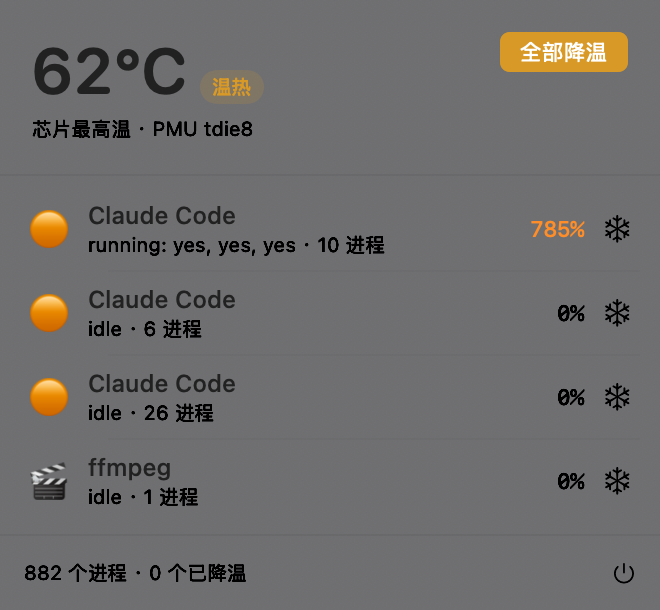

# HotPot

> 谁在烧我的 Mac？一个开源的小工具，告诉你哪个 AI agent 正在把机器烤热，并把它挪到能效核降温 —— 不打断它的工作。

灵感来自 [WhoIsCooking](https://whoiscooking.site)，独立实现，MIT 协议。



## 状态

POC 已跑通：温度读取 / agent 归因 / 一键降温 / 菜单栏面板。

- 需求与设计：[PRD.md](PRD.md)
- 实测数据与实验方法：[docs/POC-REPORT.md](docs/POC-REPORT.md)
- 给协作者/AI agent 的说明：AGENTS.md

## 构建

```bash
swift build -c release
.build/release/HotPot
```

需要 macOS 13+，Apple Silicon。

## 命令行自检

```bash
.build/debug/HotPot --dump        # 打印温度 + agent 会话 + Top CPU
.build/debug/HotPot --cool-test   # 对最烫的 agent 降温 25s 再恢复，打印温度变化
.build/debug/HotPot --render      # 离屏渲染面板到 poc-panel.png
.build/debug/HotPot --demo        # 启动后自动展开面板
```

## 原理

| 模块 | 做法 |
|------|------|
| 温度 | `IOHIDEventSystemClient`（私有 API，免 sudo） |
| 进程 | `libproc` 全表扫描 + `proc_pid_rusage` 差分算 CPU% |
| 归因 | argv 指纹 + ppid 链 + pgid 兜底 |
| 降温 | `taskpolicy -b -p PID` 降到 Background QoS（只跑能效核） |
| 恢复 | `taskpolicy -B -p PID` |

## 已知限制

- 用了私有 API，不能上 Mac App Store
- 只能降温同用户的进程（sudo 起的 docker / root 进程不行）
- 刘海形态需要带刘海的机器验证；无刘海时自动用菜单栏

## 隐私

纯本地运行，不联网，不上报任何数据。

## License

MIT
