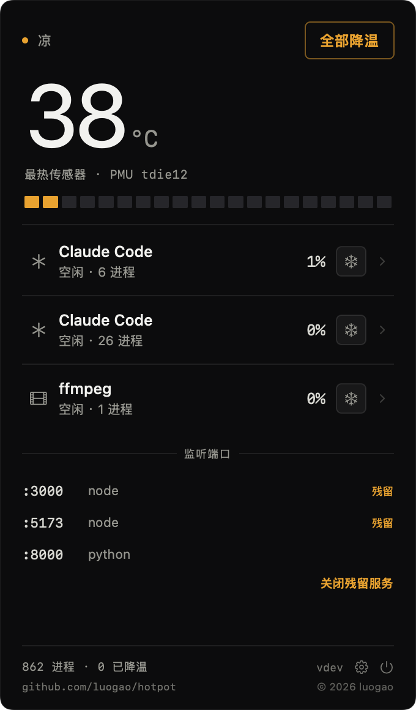
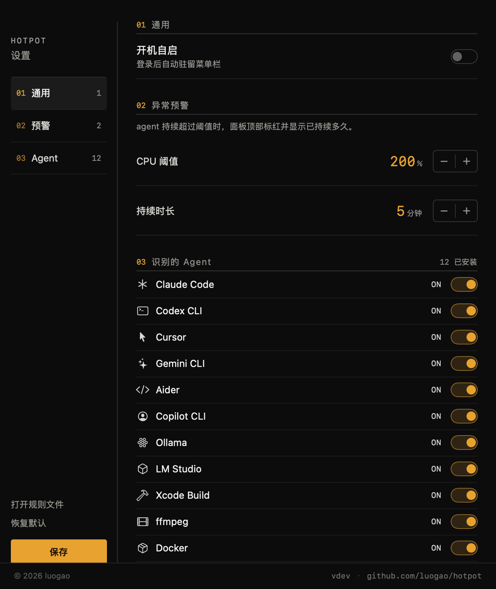

# HotPot

> 谁在烧我的 Mac？一个开源的小工具，告诉你哪个 AI agent 正在把机器烤热，并把它挪到能效核降温 —— 不打断它的工作。

<p align="center">
  &nbsp;&nbsp;&nbsp;
  
</p>

## 状态

M1 可用版：温度读取 / agent 归因 / 一键降温 / 菜单栏面板 / 连续满载预警 / 端口监控 / 设置窗口。

- 需求与设计：[PRD.md](PRD.md)
- 实测数据与实验方法：[docs/POC-REPORT.md](docs/POC-REPORT.md)
- 给协作者/AI agent 的说明：AGENTS.md

## 安装

**Homebrew（推荐）**

```bash
brew install --cask luogao/tap/hotpot
```

一条命令：Homebrew 会自动 tap 并信任这个 cask，装完直接能用（已去掉 quarantine）。

> 不要用 `brew install --cask <raw URL>` —— 新版 Homebrew 不再支持从 URL 直接装 cask，
> 会把 URL 当成 cask 名去查，报 `No Cask with this name exists`。

**下载发行版**

到 [Releases](https://github.com/luogao/hotpot/releases) 下 `HotPot-<version>.zip`，解压后拖进 `/Applications`。

**从源码**

```bash
git clone https://github.com/luogao/hotpot.git
cd hotpot
./scripts/bundle.sh          # 编译 + 打包 + ad-hoc 签名
cp -R build/HotPot.app /Applications/
open /Applications/HotPot.app
```

启动后菜单栏出现 `52°`，点一下展开面板。没有 Dock 图标（`LSUIElement`）。

首次打开若被 Gatekeeper 拦（本包是 ad-hoc 签名）：右键 →「打开」，或

```bash
xattr -d com.apple.quarantine /Applications/HotPot.app
```

**当前能力**

1. 菜单栏实时芯片温度，按温度变色
2. agent 会话归并：一个 agent 的 node/npm 子进程合成一行
3. 单个 / 全部降温与恢复（`taskpolicy` 降到能效核，进程不中断）
4. **连续满载预警**：某个会话连续 5 分钟超过 200% CPU，行内标红并显示已持续多久（面板内提示，不弹系统通知）
5. **端口监控**：列出 node / vite / python 这些开发服务占着的端口；终端关了但进程还在的标「残留」，可一键关闭
6. **设置窗口**：开机自启、预警阈值、逐个 agent 开关；已安装的 agent 默认开启监控
7. **支持 Pi**（pi coding agent）以及 Claude Code / Codex / Cursor / Gemini CLI / Aider / Copilot CLI / Ollama / LM Studio / Xcode Build / ffmpeg / Docker

**配置**：`~/Library/Application Support/HotPot/rules.json`（首次启动生成）
可加自己的 agent、白名单端口、改预警阈值。改坏了不会崩，会自动备份并回退默认。

**开机自启**：默认关闭。菜单栏图标右键 →「开机自启」开启。

**还没做**：刘海形态（当前机器无刘海）、中英双语之外的语言、Intel Mac 支持。

## 构建（开发）

```bash
swift build -c release
.build/release/HotPot --dump
```

需要 macOS 13+，Apple Silicon。

## 命令行自检

```bash
.build/debug/HotPot --dump        # 打印温度 + agent 会话 + Top CPU
.build/debug/HotPot --cool-test   # 对最烫的 agent 降温 25s 再恢复，打印温度变化
.build/debug/HotPot --render      # 离屏渲染面板（可加 --alert / --dev 注入状态）
.build/release/HotPot --ports     # 只列残留的开发服务器
.build/release/HotPot --bench     # 扫描/读温耗时基线
.build/debug/HotPot --demo        # 启动后自动展开面板
```

## 原理

| 模块 | 做法 |
|------|------|
| 温度 | `IOHIDEventSystemClient`（私有 API，免 sudo） |
| 进程 | `libproc` 全表扫描 + `proc_pid_rusage` 差分算 CPU% |
| 归因 | argv 指纹 + ppid 链 + pgid 兜底 |
| 降温 | `taskpolicy -b -p PID` 降到 Background QoS（只跑能效核） |
| 恢复 | `taskpolicy -B -p PID` |

## 已知限制

- 用了私有 API，不能上 Mac App Store
- 只能降温同用户的进程（sudo 起的 docker / root 进程不行）
- 刘海形态需要带刘海的机器验证；无刘海时自动用菜单栏

## 隐私

纯本地运行，不联网，不上报任何数据。

## 开发

```bash
./scripts/check.sh    # 编译 + 单测 + e2e，提交前跑这个
```

- `Tests/HotPotTests/` — agent 识别规则、会话聚合、看板存储（`swift test`）
- `HotPot --e2e` — 无窗口、无辅助功能权限的自检：进程扫描、会话聚合、SQLite 读写、三个视图能不能建出来
- `.github/workflows/ci.yml` — push 和 PR 跑同样三步

## License

MIT

---

灵感来自 [WhoIsCooking](https://whoiscooking.site)，独立实现。
