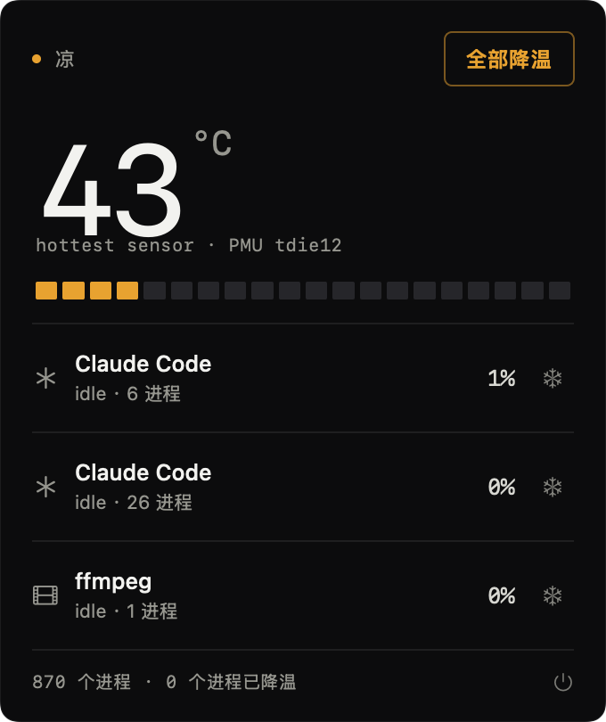
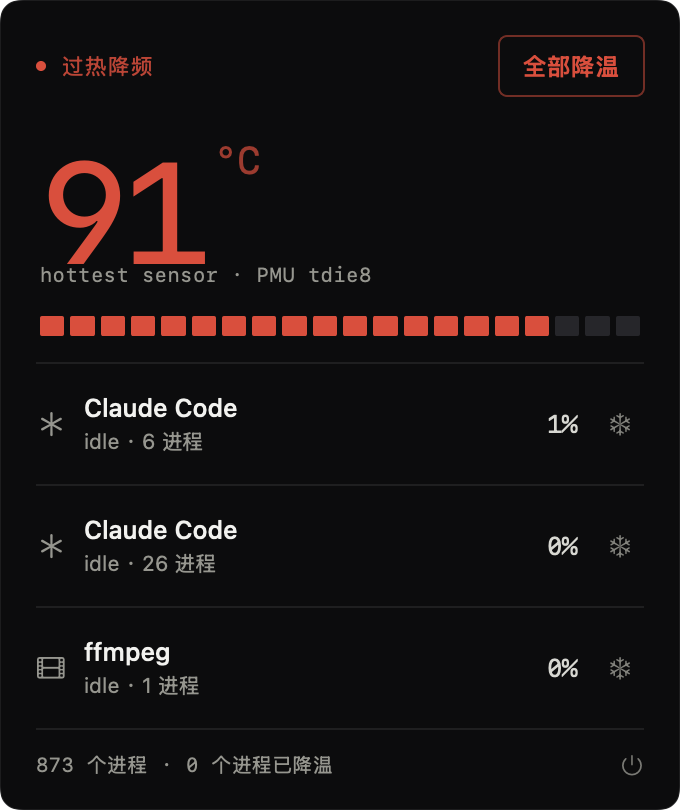

# HotPot

> 谁在烧我的 Mac？一个开源的小工具，告诉你哪个 AI agent 正在把机器烤热，并把它挪到能效核降温 —— 不打断它的工作。

灵感来自 [WhoIsCooking](https://whoiscooking.site)，独立实现，MIT 协议。



<p align="center"></p>

## 状态

M1 可用版：温度读取 / agent 归因 / 一键降温 / 菜单栏面板 / 连续满载预警 / 残留 dev server 提醒。

- 需求与设计：[PRD.md](PRD.md)
- 实测数据与实验方法：[docs/POC-REPORT.md](docs/POC-REPORT.md)
- 给协作者/AI agent 的说明：AGENTS.md

## 安装（自己用）

```bash
git clone https://github.com/luogao/hotpot.git
cd hotpot
./scripts/bundle.sh          # 编译 + 打包 + ad-hoc 签名
cp -R build/HotPot.app /Applications/
open /Applications/HotPot.app
```

启动后菜单栏出现 `52°`，点一下展开面板。没有 Dock 图标（`LSUIElement`）。

首次打开若被 Gatekeeper 拦（本包是 ad-hoc 签名）：右键 →「打开」，或

```bash
xattr -d com.apple.quarantine /Applications/HotPot.app
```

**当前能力**

1. 菜单栏实时芯片温度，按温度变色
2. agent 会话归并：一个 agent 的 node/npm 子进程合成一行
3. 单个 / 全部降温与恢复（`taskpolicy` 降到能效核，进程不中断）
4. **连续满载预警**：某个会话连续 5 分钟超过 200% CPU，行内标红并显示已持续多久（面板内提示，不弹系统通知）
5. **残留 dev server**：终端关了但 `npm run dev` 还在占端口，面板底部列出端口，可一键关闭

**还没做**：刘海形态（当前机器无刘海）、开机自启、规则表外置 JSON。

## 构建（开发）

```bash
swift build -c release
.build/release/HotPot --dump
```

需要 macOS 13+，Apple Silicon。

## 命令行自检

```bash
.build/debug/HotPot --dump        # 打印温度 + agent 会话 + Top CPU
.build/debug/HotPot --cool-test   # 对最烫的 agent 降温 25s 再恢复，打印温度变化
.build/debug/HotPot --render      # 离屏渲染面板（可加 --alert / --dev 注入状态）
.build/release/HotPot --ports     # 只列残留的开发服务器
.build/release/HotPot --bench     # 扫描/读温耗时基线
.build/debug/HotPot --demo        # 启动后自动展开面板
```

## 原理

| 模块 | 做法 |
|------|------|
| 温度 | `IOHIDEventSystemClient`（私有 API，免 sudo） |
| 进程 | `libproc` 全表扫描 + `proc_pid_rusage` 差分算 CPU% |
| 归因 | argv 指纹 + ppid 链 + pgid 兜底 |
| 降温 | `taskpolicy -b -p PID` 降到 Background QoS（只跑能效核） |
| 恢复 | `taskpolicy -B -p PID` |

## 已知限制

- 用了私有 API，不能上 Mac App Store
- 只能降温同用户的进程（sudo 起的 docker / root 进程不行）
- 刘海形态需要带刘海的机器验证；无刘海时自动用菜单栏

## 隐私

纯本地运行，不联网，不上报任何数据。

## License

MIT
