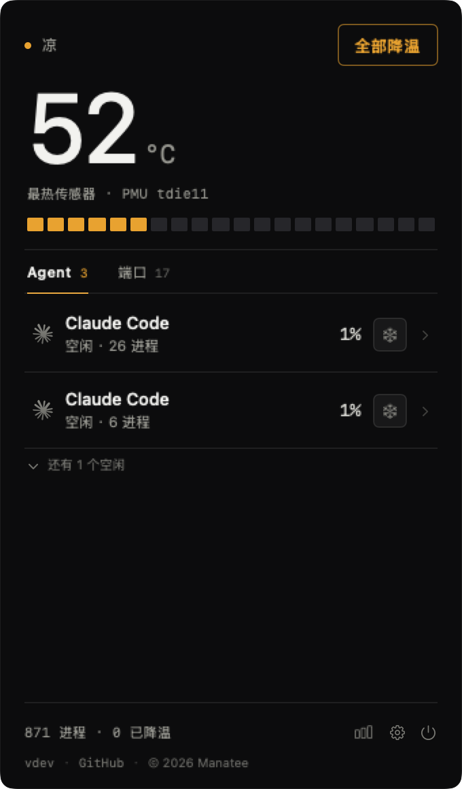
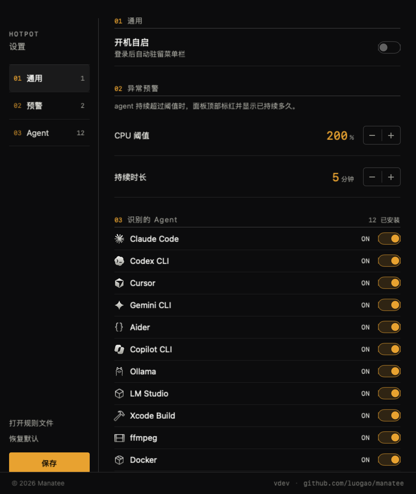
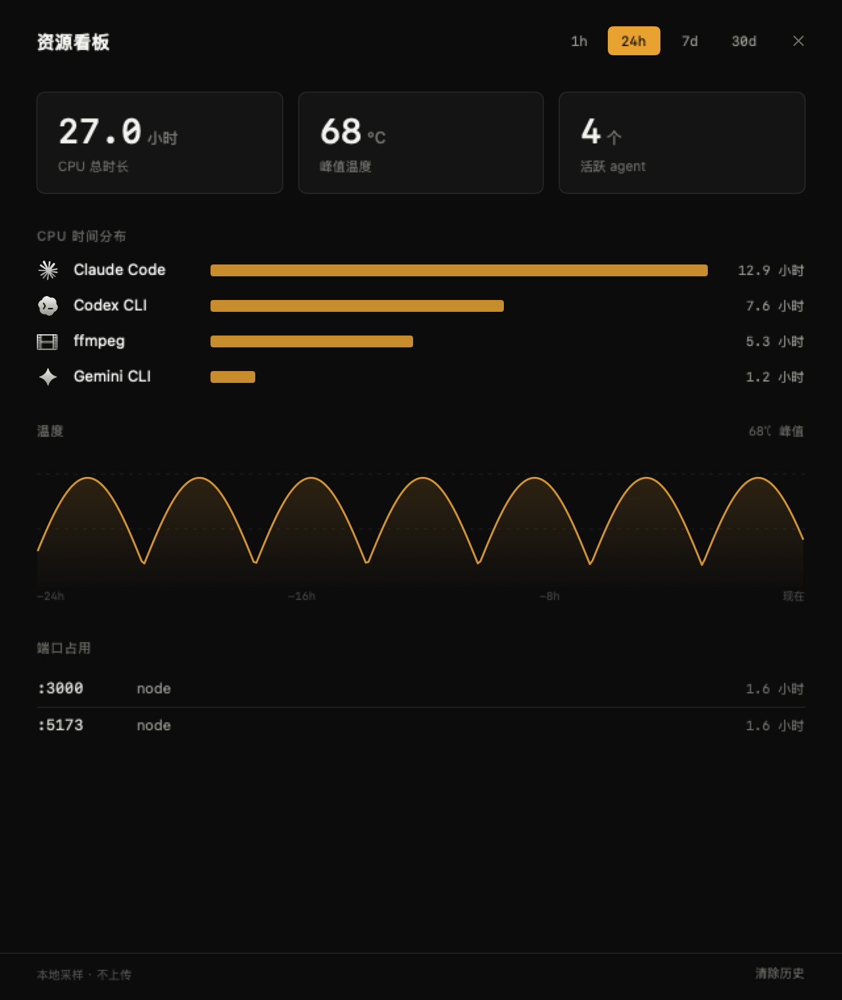

# Manatee

[English](README.md) · [简体中文](README.zh-CN.md)


[](https://github.com/luogao/manatee/releases)
[](LICENSE)
[](#安装)

**别把火关掉，把火调小。**

几个 AI agent 一起跑，风扇开始起飞。你不需要「谁在占用 CPU」这种含糊答案 —— 你要知道是哪个、跑了多久、还能不能救。

Manatee 住在菜单栏，把每个 agent 的整棵进程树合成一行，标清楚烫了多久，然后把它挪到能效核：**任务照跑，只是不抢满所有核心**。

> 名字来自海牛 —— 一天要吃自己体重十分之一的水草，消化极慢，从不冲刺。

<p align="center">
  &nbsp;&nbsp;
  &nbsp;&nbsp;
  
</p>

<p align="center"><sub>菜单栏面板 · 设置窗口 · 资源看板</sub></p>

## 功能

- **实时芯片温度** — 菜单栏直接显示 `52°`，按温度变色
- **agent 会话归并** — 一个 agent 的 node/npm/子进程合成一行，不刷屏
- **一键降温** — 把会话降到能效核，进程继续跑，只是慢一点；随时恢复
- **连续满载预警** — 某个会话连续 5 分钟超 200% CPU，行内标红并显示持续时长
- **端口监控** — 谁占着 `:5173`；终端关了进程还在的标「残留」，可一键关掉
- **资源看板** — 1h/24h/7d/30d 窗口，看谁累计吃掉最多 CPU、温度什么时候飙起来的
- **广泛的 agent 支持** — Claude Code / Codex / Cursor / Gemini CLI / Aider / Copilot CLI / Pi / Ollama / LM Studio / Xcode Build / ffmpeg / Docker

## 安装

**Homebrew（推荐）**

```bash
brew install --cask luogao/tap/manatee
```

一条命令搞定，cask 里已经去掉了 quarantine，装完直接能用。

**下载发行版**

到 [Releases](https://github.com/luogao/manatee/releases) 下载 `Manatee-<version>.zip`，解压拖进 `/Applications`。

> 本包是 ad-hoc 签名，首次打开可能被 Gatekeeper 拦。右键 →「打开」，或者：
> ```bash
> xattr -d com.apple.quarantine /Applications/Manatee.app
> ```

**从源码**

```bash
git clone https://github.com/luogao/manatee.git
cd manatee
./scripts/bundle.sh          # 编译 + 打包 + ad-hoc 签名
cp -R build/Manatee.app /Applications/
open /Applications/Manatee.app
```

> 别用 `brew install --cask <raw URL>` —— 新版 Homebrew 不支持从 URL 装 cask，
> 会把 URL 当 cask 名去查，报 `No Cask with this name exists`。

## 使用

1. 启动后菜单栏出现 `52°`，没有 Dock 图标
2. 点一下展开面板，看到当前所有 agent 会话、CPU、子进程
3. 某一行的数字太吓人，点它右边的降温按钮；想全降就点底部的「全部降温」
4. 忙完了点「恢复」，进程回到正常调度

右键菜单栏图标还有：资源看板、偏好设置、开机自启（默认关）、退出。

## 配置

配置文件在 `~/Library/Application Support/Manatee/rules.json`，首次启动生成。

可以加自己的 agent、白名单端口、改预警阈值。**改坏了不会崩** —— 会自动备份原文件并回退默认规则。

## 原理

| 模块 | 做法 |
|------|------|
| 温度 | `IOHIDEventSystemClient`（私有 API，免 sudo） |
| 进程 | `libproc` 全表扫描 + `proc_pid_rusage` 差分算 CPU% |
| 归因 | argv 指纹 + ppid 链 + pgid 兜底 |
| 降温 | `taskpolicy -b -p PID` 降到 Background QoS（只跑能效核） |
| 恢复 | `taskpolicy -B -p PID` |
| 存储 | SQLite 本地采样，原始 48 小时、小时聚合 90 天 |

### 降温到底改了什么

不是 `SIGSTOP`，不是 `nice`，进程一直在跑。改的是**调度级别**：把线程的 QoS 从 User Initiated 降到 Background。系统收到这个信号后做三件事——优先排到能效核、时间片给得更少、允许把定时器唤醒合并。

核心在于第一条。Apple Silicon 的 P 核单核功耗是 E 核的好几倍，但快不到那么多倍。同一批线程挪到 E 核，单位时间发热掉一半以上，代价是完成时间变长——对 agent 这种「等结果就行」的任务几乎无感。

<p align="center"></p>

<p align="center"><sub>8 个 CPU-bound 线程超订 6 个能效核，本机实测。完整方法与数据见 <a href="docs/POC-REPORT.md">POC-REPORT</a></sub></p>

注意这是 advisory（建议性）调度，不是硬亲和：E 核排满时线程仍会溢出到 P 核。所以效果取决于系统愿不愿意把 E 核留给你——正常负载下它会。

看板的采样策略和取舍记录在 [docs/DASHBOARD.md](docs/DASHBOARD.md)。

## 已知限制

- 用了私有 API，不能上 Mac App Store
- 只能降温同用户的进程（sudo 起的 docker / root 进程不行）
- 刘海形态需要带刘海的机器验证；无刘海时自动用菜单栏
- 目前只支持 Apple Silicon / macOS 13+

## 开发

```bash
./scripts/check.sh      # 编译 + 单测 + e2e，提交前跑这个
swift build -c release  # 出可执行文件
```

测试：`Tests/ManateeTests/` 覆盖 agent 识别规则、会话聚合、看板存储；`Manatee --e2e` 是无窗口无权限的启动链路自检。CI 跑同样的三步。

常用命令行工具：

```bash
.build/debug/Manatee --dump        # 打印温度 + agent 会话 + Top CPU
.build/debug/Manatee --cool-test   # 对最烫的 agent 降温 25s 再恢复，打印温度变化
.build/debug/Manatee --render      # 离屏渲染面板（可加 --alert / --dev 注入状态）
.build/release/Manatee --ports     # 只列残留的开发服务器
.build/release/Manatee --bench     # 扫描/读温耗时基线
.build/debug/Manatee --demo        # 启动后自动展开面板
```

更多文档：

- 需求与设计：[PRD.md](PRD.md)
- 实测数据与实验方法：[docs/POC-REPORT.md](docs/POC-REPORT.md)
- 给协作者 / AI agent 的说明：[AGENTS.md](AGENTS.md)

## 隐私

纯本地运行。不联网、不上报、不需要账号。看板数据只写在你自己的硬盘上。

## License

[MIT](LICENSE) © luogao

---

灵感来自 [WhoIsCooking](https://whoiscooking.site/)，独立实现。
